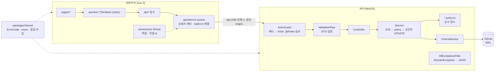

# 아키텍처

README의 "아키텍처" 절을 자세히 풀어 쓴 문서입니다. 작업 규칙 자체는 [CLAUDE.md](../CLAUDE.md)에 있습니다.

## 1. 전체 구조



| 경로 | 역할 |
|---|---|
| `packages/shared` | FE·BE가 함께 쓰는 `ErrorCode`, 에러 메시지, enum(`VISIT_STATUS` 등), API 응답 타입. ESM 전용이고 `dist`로 빌드해 소비합니다. |
| `apps/api` | NestJS API. `src/common`(횡단 관심사), `src/modules/{rooms,students,visits}`(도메인), `src/database`(연결 설정, SQLite PRAGMA) |
| `apps/web` | Vue 3 SPA. `api` → `queries` → `pages/components` 순서로만 의존합니다. |

**왜 공용 패키지인가.** 프론트가 `message`가 아니라 `code`로 분기하려면 양쪽의 코드 목록이 같아야 합니다. 코드를 문자열로 각자 적으면 오타가 런타임에야 드러납니다. shared의 `ErrorCode`는 `Record<ErrorCode, …>` 매핑(HTTP 상태, 메시지)을 통해, 코드를 추가하고 매핑을 빠뜨리면 컴파일 에러가 나게 합니다.

## 2. 요청 한 건의 흐름 (방문 신청)

`POST /api/rooms/1/visits` `{ "visitAt": "2026-11-20T10:00:00.000Z" }`, 헤더 `X-Actor-Role: STUDENT`, `X-Student-Id: 3`

1. **ActorGuard**가 `parseActor()`로 헤더를 `Actor`로 바꾸고, 핸들러의 `@Roles(STUDENT)`와 비교합니다. 헤더가 없으면 401, 역할이 다르면 403입니다. Guard는 DTO 검증보다 먼저 실행되므로, 권한 없는 요청은 body 형식과 상관없이 403을 받습니다.
2. **ValidationPipe**가 DTO를 검증합니다. `visitAt`은 시간대가 붙은 ISO 문자열이어야 합니다(`@IsIsoDateTime`). 시간대가 없으면 서버 시간대로 해석되어 9시간 어긋날 수 있기 때문입니다.
3. **VisitsService.apply**가 요청 시각을 `clock.now()`로 **한 번만** 읽습니다. 정책 판단과 이력 기록이 같은 "지금"을 써야 하기 때문입니다.
4. 자습실·학생·기존 신청을 읽고, **policy 순수 함수**(`checkVisitTime` 등)로 운영 기간·과거 시각을 검사합니다. 여기서 정확한 에러 코드가 결정됩니다.
5. 트랜잭션 안에서 **조건부 UPDATE**로 좌석을 확보합니다.
   ```
   UPDATE study_rooms SET activeCount = activeCount + 1
   WHERE id = ? AND deletedAt IS NULL AND activeCount < maxPersonnel
     AND startDate <= ? AND endDate >= ?
   ```
   0건이면 그때 원인을 다시 진단해 `ROOM_FULL` 등을 던집니다. 앞 단계의 검사는 "왜 실패했는지"를, 이 UPDATE는 "동시에 와도 안전한지"를 맡습니다.
6. 같은 트랜잭션에서 `Visit`을 만들거나(첫 신청) 취소된 신청을 다시 활성화하고(재신청, R3), `VisitHistory`를 INSERT합니다. 둘 중 하나라도 실패하면 좌석 확보까지 함께 되돌아갑니다.
7. 응답 DTO로 바꿔 돌려줍니다. `isPast`는 저장하지 않고 응답 시점에 계산합니다(R5).
8. 어느 단계에서든 `DomainException(code)`이 나오면 **AllExceptionsFilter**가 `error-status.ts` 매핑으로 HTTP 상태를 정해 `{ statusCode, code, message, timestamp, details? }`로 바꿉니다. 예상하지 못한 에러는 500 `INTERNAL_ERROR`로 나가고, 원인은 로그에만 남습니다.

## 3. 동시성 설계

정원 초과는 "COUNT 후 INSERT" 사이에 다른 요청이 끼어들 때 생깁니다. 이 프로젝트는 **검사와 변경을 한 문장으로 합치는 조건부 UPDATE**만 씁니다.

| 상황 | 한 문장에 거는 조건 | 0건일 때 |
|---|---|---|
| 신청·재신청 (좌석 확보) | `activeCount < maxPersonnel` + 운영 기간 + 삭제 안 됨 | `ROOM_FULL`, `VISIT_OUT_OF_PERIOD`, `ROOM_NOT_FOUND` 진단 |
| 재신청 (신청 행) | `status = CANCELED` | 이미 재신청됨 → `DUPLICATE_VISIT` |
| 시간 수정 | `status = ACTIVE` + `visitAt = 읽은 값` + 자습실 기간 안(관계 필터) | 이미 바뀜 → 되돌리고 진단 |
| 취소 | `status = ACTIVE` + `visitAt >= now` | `VISIT_ALREADY_CANCELED`, `VISIT_ALREADY_PASSED` |
| 자습실 수정 (R6, R7) | `activeCount <= 새 정원` + `NOT EXISTS(새 기간 밖 ACTIVE 신청)` | `CAPACITY_BELOW_ACTIVE`, `PERIOD_EXCLUDES_VISITS` + `details` |

- 메모리 락(`async-mutex`)을 쓰지 않은 이유: 서버가 두 대가 되는 순간 깨집니다. DB 조건은 서버 수와 무관합니다.
- 자습실 수정이 한 문장으로 실행되는지는 추측하지 않고 Prisma 쿼리 로그로 확인했습니다(ISSUE-004).
- 학생과 강사가 같은 신청을 동시에 취소하면 한쪽만 1건을 바꾸고, 다른 쪽은 0건이라 `VISIT_ALREADY_CANCELED`를 받습니다. 카운터는 한 번만 줄어듭니다.

### 검증 방법과 한계

- e2e: 같은 자습실에 동시 신청 N건 → 성공 수 = 정원, `activeCount` = 실제 ACTIVE 수.
- better-sqlite3는 연결이 하나라 트랜잭션이 사실상 차례로 실행됩니다. 그래서 e2e는 "동시 HTTP 요청에서 규칙이 지켜진다"까지만 증명합니다. 조건부 UPDATE 자체의 원자성은 `test/database.e2e-spec.ts`가 트랜잭션 없이 동시 UPDATE를 보내 따로 증명합니다.
- **PostgreSQL로 옮길 때 다시 볼 곳**: 기본 격리 수준(READ COMMITTED)에서는 자습실 수정의 `NOT EXISTS`가 동시에 커밋되는 신청을 못 볼 수 있습니다. 자습실 행을 `SELECT … FOR UPDATE`로 먼저 잠그는 방식으로 바꿔야 합니다. 정원 카운터 UPDATE는 행 잠금으로 그대로 안전합니다.

## 4. 이력 설계

- `Visit`은 **현재 상태**, `VisitHistory`는 **append-only 변경 기록**입니다. 둘은 항상 같은 트랜잭션에서 바뀝니다.
- 이력에는 `prevVisitAt`, `nextVisitAt`이 있어, 이력만 처음부터 재생하면 현재 신청이 나와야 합니다. 테스트는 상태를 바꾸는 시나리오마다 `replayVisitHistory()` 결과와 현재 신청을 비교합니다.
- `actorType`은 서버가 요청자 정보로 정합니다. 클라이언트가 보낸 값을 저장하지 않습니다.
- 학생의 "누가 왜 취소했나"는 `Visit`에 따로 저장하지 않고 마지막 이력에서 계산합니다. 같은 사실을 두 곳에 두면 어긋날 수 있기 때문입니다.

상세 정책(상태, 행위별 이력, 불변 조건)은 [visit-policy.md](./visit-policy.md)를 보세요.

## 5. 프론트엔드 데이터 흐름

| 계층 | 하는 일 | 하지 않는 일 |
|---|---|---|
| `api/client.ts` | 요청자 헤더 부착, axios 에러 → `ApiError` 변환 (응답 없음은 `NETWORK_ERROR`) | 화면 상태를 모름 |
| `api/*.ts` | 엔드포인트별 함수, 응답 타입 지정 | 캐시를 모름 |
| `queries/*` | TanStack Query 훅, 쓰기 후 무효화 범위 결정 | axios를 직접 부르지 않음 |
| `utils/*` | 폼 검증, 충돌 `details` 해석, 일시 변환 (순수 함수, 단위 테스트) | Vue에 의존하지 않음 |
| `pages/*`, `components/*` | 표시와 사용자 입력 | `Date`를 직접 다루지 않음, HTTP 상태로 분기하지 않음 |

- **캐시 최신성**: `staleTime`은 0입니다. 강사와 학생이 같은 데이터를 바꾸므로 요청 수보다 최신성이 중요합니다. 30초로 두었다가 강사 취소가 학생 화면에 바로 보이지 않는 문제를 브라우저에서 확인하고 바꿨습니다(ISSUE-011).
- **쓰기 후 무효화**: 신청을 바꾸는 쓰기는 `rooms`와 `me`를 함께 무효화합니다. 삭제는 상세 캐시를 지우고(404 재요청 방지) 목록 캐시에서 즉시 뺍니다.
- **재시도**: 조회는 네트워크·5xx만 최대 2번, 4xx와 쓰기는 재시도하지 않습니다. 쓰기를 자동 재시도하면 응답만 늦게 온 성공 요청을 한 번 더 보내게 됩니다.
- **요청자 무효화**: 학생 요청자가 401 또는 `STUDENT_NOT_FOUND`를 받으면(강사가 그 학생을 삭제한 경우) 전역 에러 처리가 역할을 지우고 역할 선택 화면으로 보냅니다.

## 6. 실행 형태

| 형태 | 구성 | 용도 |
|---|---|---|
| `npm run dev` | shared(watch) + api(:3000, watch) + web(Vite :5173, `/api` 프록시) | 기본 실행, 개발 |
| `docker compose up --build` | 이미지 하나, 서비스 둘: api(`node dist/main.js`) + web(`vite preview` :4173, `/api` 프록시). DB는 named volume | Node 22.12 이상이 없을 때의 대안 |

개발과 Docker 모두 웹과 API를 **같은 origin**(`/api` 프록시)으로 묶어 CORS 설정을 두지 않았습니다. 실제 배포에서도 같은 구조를 유지해, 정적 파일은 nginx·CDN이 서빙하고 `/api`만 API 서버로 보내는 리버스 프록시를 두는 것을 전제로 합니다. `vite preview`는 운영용 서버가 아니며, Docker 구성은 평가 환경 재현이 목적입니다.
