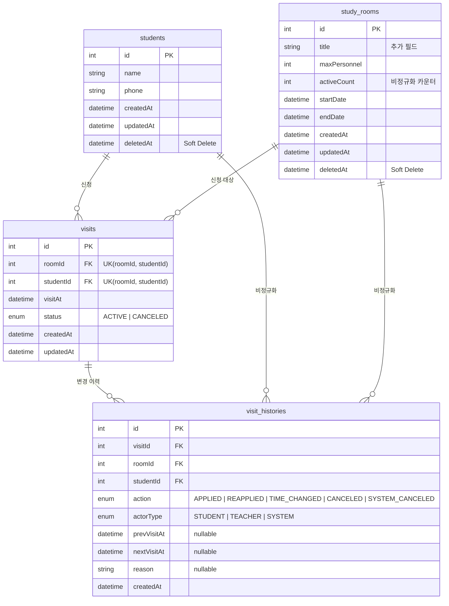

# ERD

스키마 원본: [`apps/api/prisma/schema.prisma`](../apps/api/prisma/schema.prisma)
설계 근거: [`issues/002-db-schema/README.md`](../issues/002-db-schema/README.md)

## 제약과 인덱스

| 테이블 | 제약 / 인덱스 | 목적 |
|---|---|---|
| `visits` | UNIQUE `(roomId, studentId)` | 중복 신청 방지 (R3) |
| `visits` | INDEX `(studentId, status)` | 내 신청 목록 (FR-VST-04) |
| `visits` | INDEX `(roomId, status)` | 자습실 수정 시 활성 신청 검사 (R6, R7) |
| `visit_histories` | INDEX `(roomId, createdAt)` | 자습실별 이력 시간순 조회 (FR-ROM-03) |
| `visit_histories` | INDEX `(visitId, createdAt)` | 신청 건별 이력 |
| `students`, `study_rooms` | INDEX `(deletedAt)` | 삭제 제외 목록 조회 |
| 모든 FK | `ON DELETE RESTRICT` | 물리 삭제 금지 (Soft Delete만 허용) |
