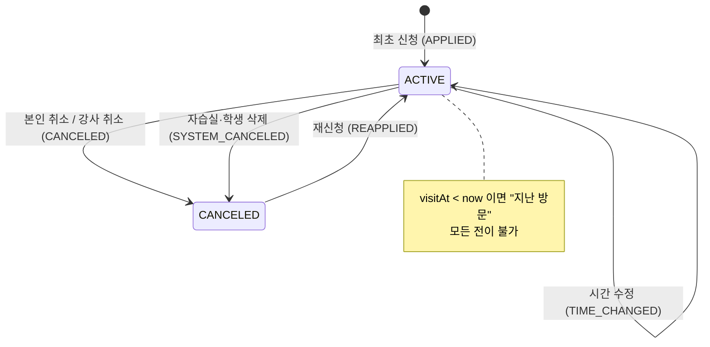

# 방문 신청·이력 정책

방문 신청과 그 이력을 어떻게 다루는지 정의합니다. 과제 문서가 모호한 부분은 이 문서의 해석을 따릅니다.
규칙 요약은 [CLAUDE.md](../CLAUDE.md) 5절(R1~R12), 구현 규칙은 7·8절에 있습니다.

## 1. 신청의 상태

DB에 저장하는 상태는 `ACTIVE`, `CANCELED` 두 가지입니다. 화면은 시각을 기준으로 세 가지로 나눠 보여줍니다.

| 화면 표시 | 조건 | 할 수 있는 일 |
|---|---|---|
| **예정** | `ACTIVE` 이고 `visitAt ≥ now` | 시간 수정(학생 본인), 취소(학생 본인, 강사) |
| **지난 방문** | `ACTIVE` 이고 `visitAt < now` | 없음. 기록으로만 남음 |
| **취소됨** | `CANCELED` | 재신청(학생 본인) |

- **"지난 방문"은 저장하지 않고 조회 시 계산합니다.** 학생이 실제로 왔는지 시스템이 알 수 없고(출석 기능 없음), `COMPLETED` 같은 상태를 두면 주기적으로 상태를 바꾸는 배치 작업이 필요하기 때문입니다.
- 지난 방문도 `ACTIVE`이므로 **정원을 계속 차지합니다.** 정원은 "시간대별 동시 인원"이 아니라 "자습실별 신청 총수"(R1)이기 때문입니다.
- 경계 기준은 하나입니다: **`visitAt < now`이면 지난 방문.** 신청·수정·취소 모두 이 기준을 씁니다. `now`는 서버의 `Clock`이 정합니다.

## 2. 행위별 규칙과 이력

모든 상태 변경은 **같은 트랜잭션 안에서 이력 1건을 함께 기록**합니다.
이력의 `prevVisitAt` / `nextVisitAt`은 "행위 직전·직후의 **유효한** 방문 시각"입니다. 취소 상태에는 유효한 방문 시각이 없으므로 `null`입니다.

| 행위 | 누가 | 전제 조건 | 결과 | 이력 action / actor | prev → next |
|---|---|---|---|---|---|
| 최초 신청 | 학생 본인 | 자습실·학생이 삭제되지 않음, R4, 정원 여유 | 신청 행 생성, `activeCount +1` | `APPLIED` / `STUDENT` | `null` → 신청 시각 |
| 재신청 | 학생 본인 | 기존 신청이 `CANCELED` + 최초 신청 조건 | 같은 행을 `ACTIVE`로, `activeCount +1` | `REAPPLIED` / `STUDENT` | `null` → 신청 시각 |
| 시간 수정 | 학생 본인 | 예정 상태, 새 시각이 R4를 만족 | `visitAt` 변경 | `TIME_CHANGED` / `STUDENT` | 기존 → 새 시각 |
| 본인 취소 | 학생 본인 | 예정 상태 | `CANCELED`, `activeCount −1` | `CANCELED` / `STUDENT` | 기존 → `null` |
| 강사 취소 (R11) | 강사 | 예정 상태, **사유 필수(최대 200자)** | `CANCELED`, `activeCount −1` | `CANCELED` / `TEACHER` + 사유 | 기존 → `null` |
| 시스템 취소 (R8, R9) | 시스템 | 자습실·학생 삭제 시 **예정 신청만** | `CANCELED`, `activeCount −n` | `SYSTEM_CANCELED` / `SYSTEM` + 사유 | 기존 → `null` |

- 강사 취소는 별도 action을 만들지 않고 `CANCELED`에 actor `TEACHER`로 구분합니다. 스키마 변경이 없습니다.
- 학생 본인 취소의 사유는 선택입니다.
- 같은 시각으로 시간을 수정하면 아무것도 바꾸지 않고 200을 반환하며 **이력을 남기지 않습니다**(R12). 실제 변경이 없으므로 기록할 일도 없고, `PATCH`는 같은 요청을 반복해도 결과가 같아야 하기 때문입니다.
- 이력의 `createdAt`은 서비스가 `clock.now()`로 지정합니다. 조회 시 `createdAt`, `id` 순으로 정렬합니다.

### 거부되는 경우

| 상황 | 응답 |
|---|---|
| 요청자 헤더가 없거나 형식이 틀림 | 401 `ACTOR_REQUIRED` |
| 역할이 맞지 않음 (예: 학생이 자습실 수정) | 403 `FORBIDDEN_ROLE` |
| 다른 학생의 신청을 수정·취소 | 403 `FORBIDDEN_VISIT_OWNER` |
| 삭제된 자습실·학생, 없는 신청 | 404 `ROOM_NOT_FOUND` / `STUDENT_NOT_FOUND` / `VISIT_NOT_FOUND` |
| 이미 활성 신청이 있는데 또 신청 | 409 `DUPLICATE_VISIT` |
| 정원 초과 | 409 `ROOM_FULL` |
| 지난 방문을 수정·취소 | 409 `VISIT_ALREADY_PASSED` |
| 이미 취소된 신청을 수정·취소 | 409 `VISIT_ALREADY_CANCELED` |
| 강사 취소인데 사유가 없음 | 400 `CANCEL_REASON_REQUIRED` |
| 운영 기간 밖의 시각 | 422 `VISIT_OUT_OF_PERIOD` |
| 지나간 시각으로 신청·수정 | 422 `VISIT_IN_PAST` |

## 3. 강사의 자습실 수정·삭제와 신청

| 강사의 행위 | 규칙 |
|---|---|
| 정원 축소 (R6) | 새 정원 < 활성 신청 수(지난 방문 포함)이면 409 `CAPACITY_BELOW_ACTIVE`. `details`에 **강사가 취소할 수 있는 예정 신청 목록**을 담음 |
| 기간 변경 (R7) | 새 기간 밖으로 밀려나는 활성 신청(지난 방문 포함)이 있으면 409 `PERIOD_EXCLUDES_VISITS`. `details`에 해당 신청 목록을 담음 |
| 자습실 삭제 (R8) | 허용. 예정 신청만 시스템 취소, 사유 "자습실 삭제". 지난 방문은 `ACTIVE` 유지 |
| 학생 삭제 (R9) | 허용. 예정 신청만 시스템 취소, 사유 "학생 삭제". 지난 방문은 `ACTIVE` 유지 |

강사가 충돌을 해결하는 흐름:

1. 정원을 3으로 줄이려 했는데 활성 신청이 4건이라 409를 받습니다.
2. 응답의 `details`에서 취소할 예정 신청을 골라 사유와 함께 취소합니다(R11).
3. 다시 정원 축소를 요청합니다.

- 기간 변경으로 **지난 방문**이 밀려나면 강사도 해소할 수 없으므로, 그 기간으로는 변경할 수 없습니다. 운영 기간 밖의 방문 기록이 생기는 것을 막기 위함입니다.
- 자습실 자체의 변경 내역(정원·기간)은 신청 이력에 남기지 않습니다. 과제 요구는 신청 이력이며, 자습실 변경 이력은 확장 항목입니다.

### 왜 거부 + 강사 취소인가

| 안 | 정원 축소 시 동작 | 판단 |
|---|---|---|
| A. 거부만 | 409. 강사는 학생이 취소할 때까지 기다려야 함 | 강사의 업무가 막힘 |
| **B. 거부 + 강사 개별 취소 (채택)** | 409와 신청 목록을 반환. 강사가 직접 골라 취소한 뒤 다시 축소 | 데이터를 몰래 바꾸지 않으면서 해결 방법이 있음. 누가 왜 취소했는지 이력에 남음 |
| C. 자동 취소 | 늦게 신청한 순서로 시스템이 취소 | 누구를 취소할지 시스템이 임의로 정함 |

### 왜 지난 방문은 시스템 취소에서 제외하는가

자습실 운영이 끝난 뒤 정리하려고 삭제하는 것은 흔한 일입니다. 활성 신청을 전부 취소하면 **실제로 방문한 기록이 "시스템 취소"로 왜곡**됩니다. 시스템 취소의 목적은 학생이 앞으로 헛걸음하지 않게 하는 것이므로, 예정 신청만 대상으로 합니다.

삭제된 자습실의 `activeCount`는 남은 지난 방문 수만큼 0이 아닐 수 있습니다. 삭제된 자습실은 신청 대상이 아니므로 정원 검사에 영향이 없습니다.

## 4. 불변 조건

| 불변 조건 | 지키는 장치 |
|---|---|
| `activeCount` = 그 자습실의 `ACTIVE` 신청 수 (지난 방문, 삭제된 자습실 포함) | 상태 변경과 같은 트랜잭션에서만 증감 + 정합성 테스트 |
| 운영 중인 자습실에서 `activeCount ≤ maxPersonnel` | 조건부 원자적 UPDATE (신청, 정원 축소) |
| (자습실, 학생)당 신청 행 1개 | DB 유니크 제약 |
| 신청 상태 변경 1회 = 이력 정확히 1건 | 같은 트랜잭션, `VisitsService` 한 곳에서만 처리 |
| 이력은 수정·삭제되지 않음 | append-only 규칙 |
| **신청의 현재 상태 = 이력을 처음부터 다시 적용한 결과** | 이력 재생 테스트 (ISSUE-006) |

마지막 조건은 "이력만으로 현재 상태를 복원할 수 있다"는 뜻입니다. 이력 설계가 맞는지 보여주는 가장 강한 증거이므로 테스트로 검증합니다.

- 마지막 이력이 `CANCELED` 또는 `SYSTEM_CANCELED`이면 신청 상태는 `CANCELED`
- 그 외이면 `ACTIVE`이고, 마지막 이력의 `nextVisitAt` = 신청의 `visitAt`

## 5. 학생에게 보이는 정보

"내 신청 목록"에 신청마다 상태(예정 / 지난 방문 / 취소됨)와, 강사·시스템이 취소한 경우 **누가 왜 취소했는지**를 보여줍니다.
과제 발문의 "신청은 했는데 제가 명단에 있는 건지 모르겠어요"라는 불만을 해결하기 위함입니다.

## 6. 요청자 식별: 왜 body가 아니라 헤더인가

| 헤더 | 값 | 필수 |
|---|---|---|
| `X-Actor-Role` | `TEACHER` \| `STUDENT` | 모든 API (health 제외) |
| `X-Student-Id` | 학생 id | `X-Actor-Role: STUDENT`일 때 |

| 이유 | 설명 |
|---|---|
| 일관성 | 자습실 삭제(`DELETE`), 이력 조회(`GET`)처럼 body가 없는 요청에도 같은 방식으로 적용됩니다. HTTP 명세상 GET body는 의미가 정의되어 있지 않습니다. |
| 처리 순서 | NestJS는 Guard → Pipe(DTO 검증) 순으로 실행합니다. 권한이 없으면 검증 에러보다 403이 먼저 나가야 권한 없는 사용자에게 검증 규칙이 노출되지 않습니다. |
| 응집도 (DRY) | body에 넣으면 모든 요청 DTO에 역할 필드를 반복해야 하고, 하나라도 빠뜨리면 권한 검사 없이 열립니다. |
| 무결성 | 이력의 `actorType`은 서버가 요청자 정보로 정해야 합니다. 요청 데이터와 요청자 정보를 분리하면 클라이언트가 보낸 값을 그대로 저장하는 실수가 어려워집니다. |
| 확장성 | 실제 인증(`Authorization: Bearer <JWT>`)도 헤더입니다. 로그인을 붙일 때 `parseActor()` 하나만 바꾸면 됩니다. |

다른 위치를 쓰지 않는 이유: 쿼리 스트링은 URL이 서버 로그와 브라우저 기록에 남고, 경로(`/teacher/rooms`)는 같은 자원이 역할마다 다른 URL을 갖게 되며, 쿠키·세션은 로그인 생략 조건에 비해 구현 부담이 큽니다.

**한계:** 헤더도 누구나 조작할 수 있습니다. 이 방식의 의미는 보안이 아니라 **인증이 들어갈 자리를 올바른 곳에 미리 만들어 두는 것**입니다. 과제가 로그인 생략을 허용한 데 따른 한계이며, 운영에서는 JWT로 교체합니다.

## 7. 구현 위치

| 내용 | 이슈 |
|---|---|
| `ErrorCode`(이 문서의 코드 전체), `parseActor()`, `RolesGuard`, `@Roles`, `@CurrentActor`, Clock | ISSUE-003 |
| 신청·재신청·시간 수정·본인 취소, 이력 기록, 이력 재생·카운터 정합성·동시성 테스트 | ISSUE-006 |
| 정원 축소·기간 변경 거부(R6, R7), 자습실 삭제 시 시스템 취소(R8) | ISSUE-004 |
| 학생 삭제 시 시스템 취소(R9) | ISSUE-005 |
| 강사 취소(R11) | ISSUE-007 |
| 내 신청 목록 (상태, 취소 사유) | ISSUE-008 |
